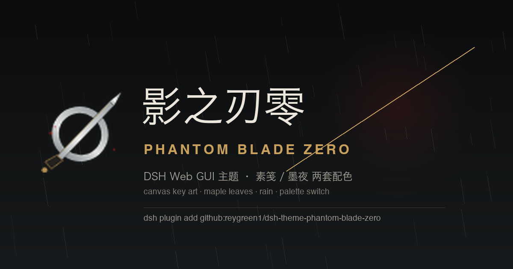
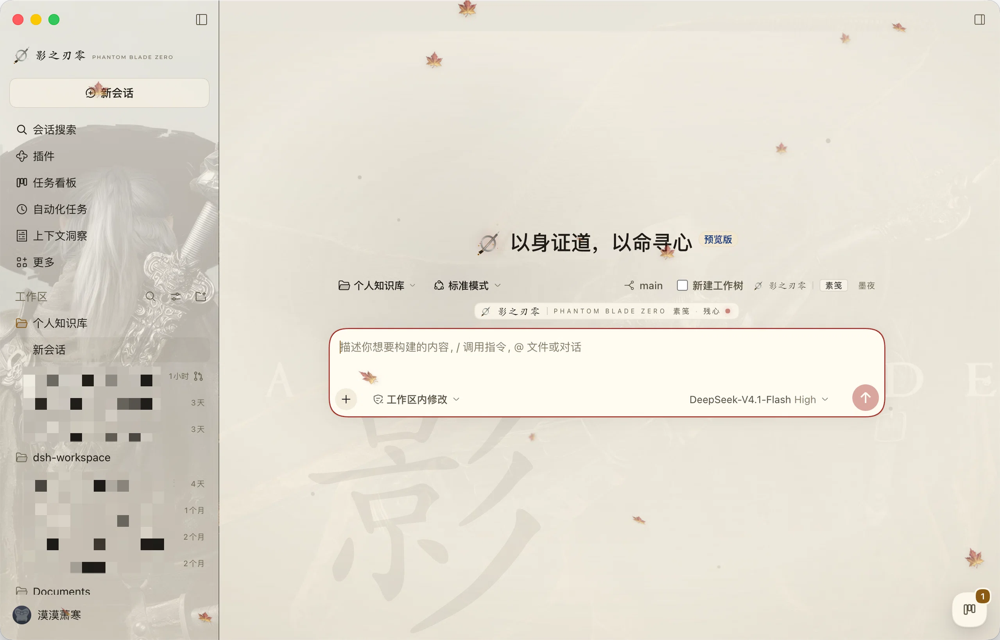
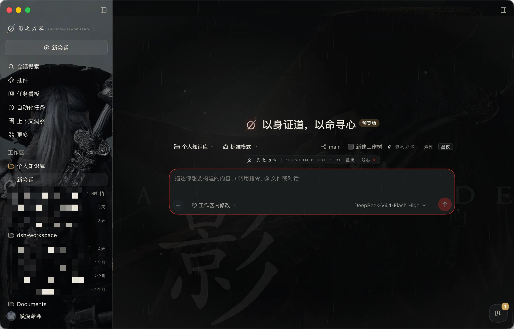

# dsh-theme-phantom-blade-zero

影之刃零 (Phantom Blade Zero) theme bundle for the DeepSeek Harness Web GUI —
two complete palettes (素笺 / 墨夜), the key art as the conversation canvas, the
game's 「Ø」 blade mark, drifting maple leaves, fine rain and a palette switch.



## Screenshots

| 素笺 · rice paper | 墨夜 · ink night |
| --- | --- |
|  |  |

## Install

From this repository:

```sh
dsh plugin add github:reygreen1/dsh-theme-phantom-blade-zero
```

or from an installed checkout:

```sh
dsh plugin add /path/to/dsh-theme-phantom-blade-zero
```

Requires DSH `>=0.2.2-rc.5 <0.3.0`. After installing, enable the bundle in
**Settings → Plugins** and restart once; the theme appears in the palette
switch above the composer.

From Discover: the public market indexes only list bundles published to npm,
and this one installs from Git, so it ships its own index:

```
https://reygreen1.github.io/dsh-theme-phantom-blade-zero/index.json
```

Add it in **Plugins → Discover → 索引源 → 管理索引源…**, then search for
影之刃零. The index lives in `docs/market/` and pins a Git commit of this
repository; `npm publish` would make the public indexes list it instead.

## Note on bundled artwork

`client.js` embeds two key-art frames as WebP data URIs. They are included for
personal, non-commercial use with the theme; the rest of the artwork (the 「Ø」
mark, the icon, the preview, the rain tiles) is drawn here. If you redistribute
this bundle, keep the artwork out unless you hold the rights to it.

## What it changes

- **Two complete themes** — 素笺 (Rice paper, light) and 墨夜 (Ink night, dark).
  Each theme is one `ctx.theme.overrideTokens` layer covering 106 design tokens
  (about 100 semantic roles × their token names): app and layered surfaces,
  borders, all three text tiers, brand and brass accents, the whole button
  family, menus and menu headers, cards, code blocks and inline code, markdown
  tags/citations, scrollbars, document selection, toasts, tooltips, hovercards,
  bubbles, switch thumb, illustration colors, chart colors, skeletons, states,
  and the macOS sidebar glass (tint washes included).
- **One switch, two states** — the palette pill calls `ctx.theme.setTheme` and
  swaps the token layer together, so choosing a theme also moves the Appearance
  preference; a `theme/change` subscription keeps the layer on whichever scheme
  the page is in, so editing Appearance in Settings retints the theme instead
  of leaving a light layer on a dark page. Nothing is stored per browser.
- **Canvas** — the owner's local key art, embedded as one data URI and painted
  on the conversation column itself (the frame's direct child that holds the
  Conversation), so the print always sits above the window canvas and below
  every piece of content. The light palette washes it with a paper scrim, the
  dark palette with an ink scrim. Fine rain drifts over the frame in dark
  mode. The transcript region is forced transparent so its own surface cannot
  wash the print out a second time.
- **Autumn drift (素笺 only)** — eighteen maple leaves, generated from one seed
  (even lane slots with jitter; size, opacity, fall period 18–40s, start delay,
  depth blur and sway period drawn independently), fall through the frame on
  their own lanes and negative delays. The glyph is
  the platform's 🍁 (real veins, shading and stem — a hand-drawn silhouette
  reads as a paper star at 20px), toned with `saturate`/`sepia` and a soft
  shadow. Each leaf nests two elements: the outer one falls at constant speed,
  the inner one sways and tumbles on an off-axis `rotate3d` on a different
  period, which squashes the glyph as it turns edge-on. Far leaves carry a
  small blur for depth. Hidden in the ink theme and under reduced motion.
- **Rain (墨夜 only)** — two generated sheets. Every drop is a tapered streak
  (SVG gradient along its own bounding box: transparent tail, bright head) and
  nearly vertical, with random length, width and opacity; the near sheet is
  long and fast with a slow gust on its opacity, the far sheet short and dim.
- **Sidebar artwork** — a second, portrait key-art frame for the left column
  only, so it never matches the conversation canvas. It is painted on the
  frame's direct child that holds this theme's sidebar mark (`.pbz-side`), with
  a mode-aware scrim over it; the rule uses `:has()` plus `!important` because
  the host column's own glass gradients are macOS-specific and would otherwise
  win.
- **Home canvas** — a `conversation.hero.frame` HOC layer behind the
  Conversation adds a mode-aware veil, an ink vignette, the 影 watermark and
  splatter over the column art; it carries no second copy of the photo, which
  would double-print at a different crop. Inside a session it fades to 45%.
- **Headline** — the blank-session line becomes 「以身证道，以命寻心」. The
  host headline lives in the `conversation` locale namespace, which refuses a
  second dictionary for an existing locale, so the theme adds a language
  variant of the active language (`<base>-x-pbz`, falling back to `<base>`,
  labelled 影之刃零) that overrides only `hero.headline`, and selects it.
  Picking another language in Settings turns the line off; disabling the
  plugin restores the previous language and removes the pack.
- **Brand** — the sidebar mark (`sidebar.brand.mark`, priority -10) and the
  brand name (`sidebar.brand.name`, priority -10) are replaced by the game's
  own logomark — the brushed 「Ø」 that the blade crosses in the
  `PHANTOM BLADE Ø` wordmark — and a one-line brush lockup (影之刃零 PHANTOM
  BLADE ZERO). The host brand row is a single fixed-height line, so a stacked
  two-line lockup was squeezed and clipped. The blank-session hero mark uses the same emblem with a glow, a
  glint, and drifting embers.
- **Composer** — a self-sized status chip in the dock above the composer
  (seal, title, wordmark, live palette, 残心 dot) plus a crimson hairline on
  the composer card that intensifies into an inset ring on focus. A
  full-width strip read as loose text floating over the column, because the
  dock is wider than the composer card.
- **Palette pill** — the composer dock and the new-session row carry the
  same control: seal, theme name, then 素笺 / 墨夜 as two labelled chips (the
  earlier 11px dots were unreadable and got clipped by the dock). The switch writes the Appearance preference (so it persists
  through the Host settings), and disabling the plugin leaves the last chosen
  scheme in place.

All motion is CSS and turns off under `prefers-reduced-motion`. Every
registered resource is returned from `ctx.effect`, so disabling the plugin
restores the stock look immediately.

## Files

| File | Role |
|---|---|
| `index.js` | Host half; registers nothing. |
| `client.js` | Browser half: wallpaper, palette layer, canvas stylesheet, seats, HUD, pills. |
| `cordis.patch.yml` | Inserts the `phantom-blade-zero` row. |
| `locale/{en,zh}.json` | Plugin Manager title, description, and detail document. |
| `icon.svg` | Blade-and-seal icon. |
| `docs/` | One-image detail documents. |

## Development notes

Hand-written browser bundle (no build step): the module registers a lazy
factory with `window.__ModuleLoader__.load`, requires only `react`, and returns
a plugin with `inject: ['slots', 'theme', 'locale']`. Every registered resource
is returned from `ctx.effect`.

**Wallpaper:** the key art is supplied by the owner for personal use and
embedded as a WebP data URI in `client.js` (`WALLPAPER`); it is not a
redistributable asset of this bundle and must not be republished with it. The
rest of the artwork (emblem, icon, preview, rain tile) is drawn from scratch.

**Headline:** the language variant is an API-level workaround for host copy, not
a DOM patch. It writes a locale preference while enabled; the effect restores
the previous language and removes both the dictionary and the language
definition on dispose.

The status strip deliberately rides `conversation.input.dock` rather than
`shell.bottom`, which already holds the inspector panel.

**Inline data URIs:** every embedded artwork must close as
`'url("data:image/webp;base64,…")'`. A dropped closing `"` still parses as
JavaScript, but the resulting CSS `url(` string is unterminated and Chrome
silently discards the whole stylesheet after the rule that contains it — the
theme then degrades to tokens only (no wallpaper, no seats, no chip). This is
exactly the failure that shipped with the sidebar artwork; `url("` and `")`
counts in the generated stylesheet must match.

Emblem colors ride `--pbz-*` variables so the light palette darkens the steel
instead of forking the artwork. A token renamed in a later DSH release degrades
appearance only.
